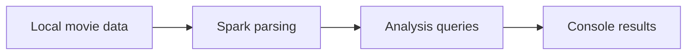

# Movie Analytics with Spark

### Recovered Scala coursework for exploring movie data.

**Scala · Apache Spark**

*Archived coursework / research prototype · Not actively maintained*

A compact recovered movie-analysis project centered on `Movie.scala`. The source is preserved for inspection and adaptation to a local Spark environment.

## What is included

- Scala analysis entry point
- Spark-based movie-data processing
- Original source organization available as a download

The repository includes 1 directly browsable source/notebook file and a [source archive](source.zip) containing 1 file with their package structure preserved. See [SOURCE_INDEX.md](SOURCE_INDEX.md) for its contents. Reference components retain their labels and upstream notices.

## Workflow

*Diagram reconstructed from the recovered source or project description.*

## Explore / run

Extract `source.zip`, inspect `Movie.scala` for input and dependency settings, and configure a compatible Scala/Spark environment. Supply the expected dataset locally.

### Direct source files

- [Movie.scala](Movie.scala)

## Project status

No verified result table or matching report was recovered. This is an archived coursework source collection; no new performance or authorship claim is made.

No training, benchmark, paid API request, or external service deployment was performed to prepare this showcase. Team names, student IDs, raw personal documents, and embedded credentials are excluded from the public upload copies. Additional scope notes are in [SOURCE_NOTES.md](SOURCE_NOTES.md).
